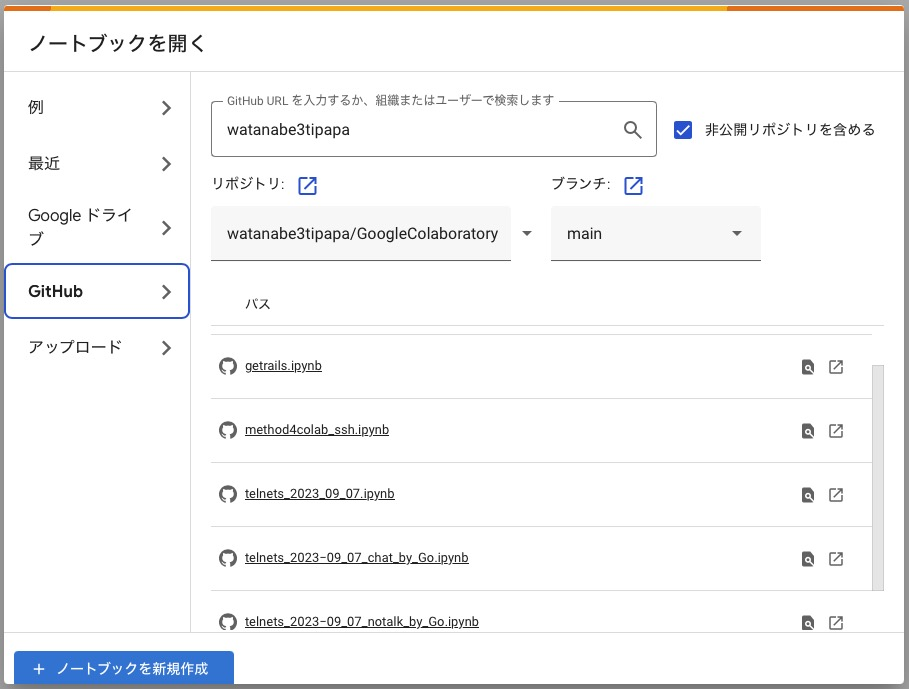

::: callout-note
## ワークショップなどで使用したものを陳列します
:::

## Colab の準備（setup/）

| Files | 用途 |
|-------------------|---------------|
| [Colab接続](https://github.com/watanabe3tipapa/GoogleColaboratory/blob/main/setup/BaseGitHub2GoogleColaboratory.ipynb) | GitHub上のファイルをColabから直接実行する下準備。 {width="380"} |
| [Colab - SSH](https://github.com/watanabe3tipapa/GoogleColaboratory/blob/main/setup/method4colab_ssh.ipynb) | 今は「禁じ手」。学習用にしてください。 |

## ネットワーク（network/）

| Files | 用途 |
|-------------------|---------------|
| [インターネット公告（simple）](https://github.com/watanabe3tipapa/GoogleColaboratory/blob/main/network/telnets_2023_09_07.ipynb) | インターネット公告 |
| [インターネット公告（chat）](https://github.com/watanabe3tipapa/GoogleColaboratory/blob/main/network/telnets_2023%E2%88%9209_07_chat_by_Go.ipynb) | インターネット公告 |
| [インターネット公告（no-talk）](https://github.com/watanabe3tipapa/GoogleColaboratory/blob/main/network/telnets_2023%E2%88%9209_07_notalk_by_Go.ipynb) | インターネット公告 |

## データ処理（data/）

| Files | 用途 |
|-------------------|---------------|
| [路線と駅名を調べる](https://github.com/watanabe3tipapa/GoogleColaboratory/blob/main/data/getrails.ipynb) | 各都道府県の鉄道路線を探査。路線の駅名と駅の緯度・経度情報を取得できます。 |

## LLM（llm/）

| Files | 用途 |
|-------------------|---------------|
| [Strata を Colab で動かす](https://github.com/watanabe3tipapa/GoogleColaboratory/blob/main/llm/strata_colab_guide.ipynb) | Colab 上で Strata 推論エンジンをセットアップし、OpenAI 互換 API でチャットする手順。 |

------------------------------------------------------------------------

This is a simple site created with Quarto.
